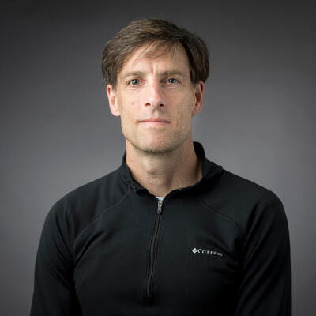
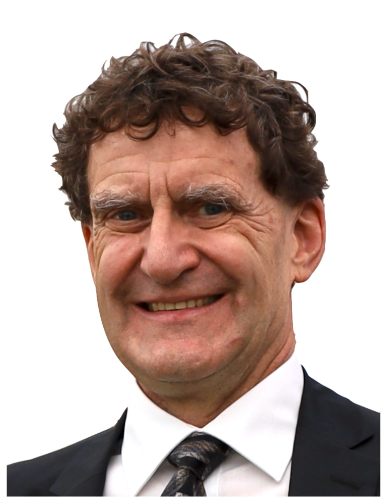

## Keynote Speakers

  
  

    <h3>Alan Fern</h3>
    
<strong>Professor of Computer Science, School of EECS, Oregon State University</strong>

    
Alan Fern is a Professor of Computer Science in the School of Electrical Engineering and Computer Science (EECS) at Oregon State University (OSU) and a Fellow of the Association for the Advancement of Artificial Intelligence (AAAI). He received his Ph.D. in Computer Engineering from Purdue University in 2004 and his B.S. in Electrical Engineering from the University of Maine in 1997.

    
His research spans artificial intelligence and robotics, with a particular emphasis on building systems that learn from experience. He is the Director of AI for the AgAID National AI Institute, which focuses on AI applications in agriculture, particularly specialty crops. Through AgAID, he has helped develop predictive systems that are regularly used by growers throughout the Pacific Northwest. He also directs the Dynamic Robotics and AI Laboratory (DRAIL), which develops AI approaches to enable robots to work in the real world.

  

  
  

    <h3>Allen D. Malony</h3>
    
<strong>Professor of Computer Science, School of Computer and Data Sciences, University of Oregon</strong>

    
Allen D. Malony is a Professor of Computer Science in the School of Computer and Data Sciences at the University of Oregon (UO) and the Director of the Oregon Advanced Computing Institute for Science and Society (OACISS). He received his Ph.D. in Computer Science from the University of Illinois Urbana-Champaign.

    
Dr. Malony's primary research is in parallel and high-performance computing (HPC), principally in methods and tools for HPC performance measurement, analysis, and visualization. His interests span interdisciplinary research areas, and he has been involved in computational and data science applications and development in a variety of domains, including neuroscience, chemistry, microscopy, earthquake science, and fusion research. His current work focuses on integrating HPC and AI in different scientific research contexts, particularly with respect to system requirements and performance. Dr. Malony was named the Fulbright-Tocqueville Distinguished Chair to France in 2016 and the Fulbright-Nokia Distinguished Chair in Information and Communications Technology in 2022.

  

